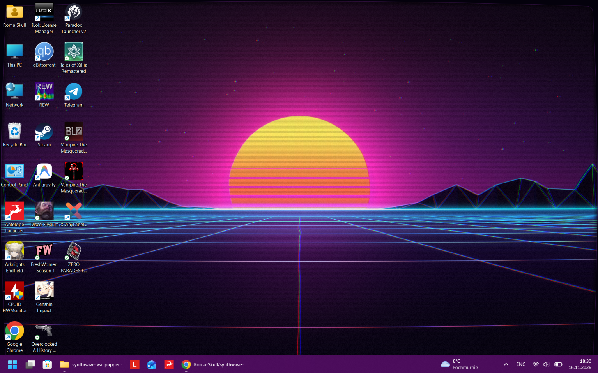
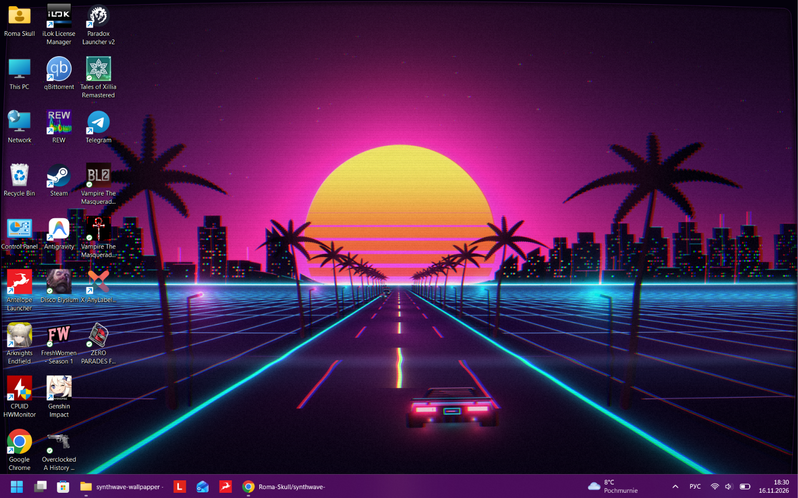
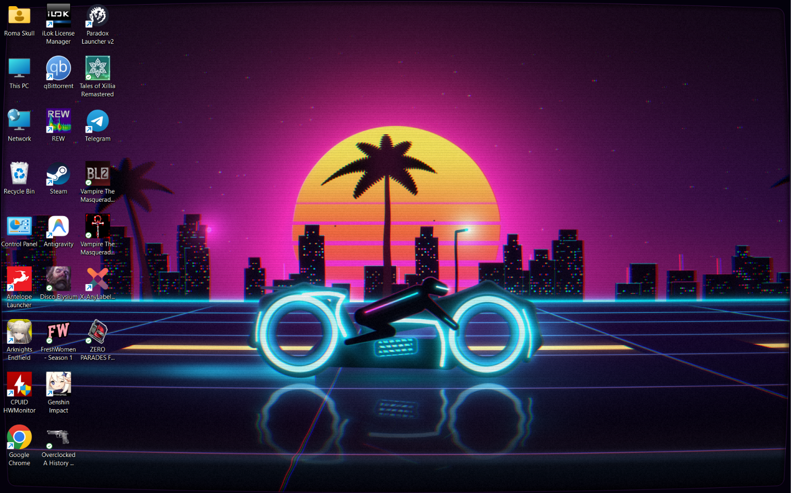
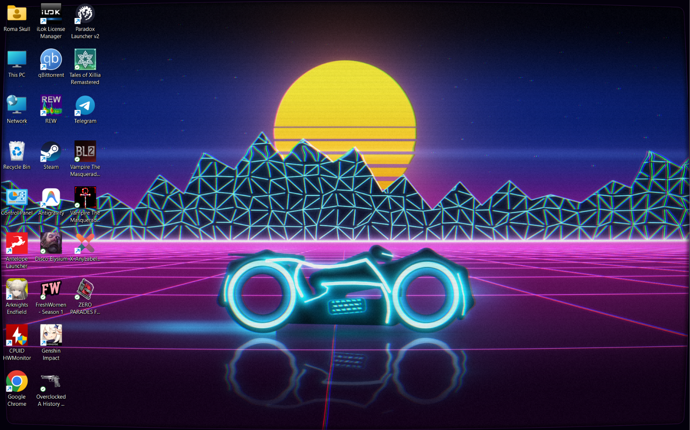

# Neon Horizon — Живые Synthwave & CRT/VHS обои

Процедурные анимированные обои в эстетике **Synthwave / Outrun 84** и аналогового **CRT / VHS-шейдера**, вдохновлённые живой новой вкладкой из проекта [retro-browser](https://github.com/Roma-Skull/retro-browser).

Работают напрямую на видеокарте через нативные шейдеры — без браузерных движков и сторонних лаунчеров.

## Платформы

- **Windows** *(доступно сейчас)* — нативный рендер на **Direct3D 11 + DirectComposition + HLSL**, встраивание строго за значками рабочего стола без сторонних программ вроде Wallpaper Engine или Lively Wallpaper.
- **Android** *(доступно сейчас)* — нативные живые обои на **WallpaperService + OpenGL ES 3.0 (GLSL ES 3.00)** с живым превью, полным набором настроек, адаптацией под любые портретные/горизонтальные экраны и `Surface.setFrameRate()` для LTPO-дисплеев.

---

## Скриншоты

| Neon Horizon (`neon_horizon`) | Miami Sunset Drive (`miami_drive`) |
| :---: | :---: |
|  |  |
| **Light Cycle (`light_cycle`)** | **Outrun Cycle (`outrun_cycle`)** |
|  |  |

---

## Возможности

- **Выбор из нескольких процедурных сцен (через панель настроек или меню в трее):**
  1. **Neon Horizon (`neon_horizon`):** сумеречное синтвейв-небо с авророй, мерцающие звёзды с 4-лучевыми бликами, закатное Outrun-солнце с дышащей короной и сползающими полосами-срезами, каркасные low-poly горы, бесконечный полёт над перспективой неоновой сетки и яркая линия горизонта.
  2. **Miami Sunset Drive (`miami_drive`):** ретро-спорткар, едущий в закат по 4-полосному проспекту Майами, встречный трафик (легковушки и фуры), неоновый скайлайн Майами в стиле Art Deco, пролетающие за пределы экрана пальмы и уличные фонари.
  3. **Light Cycle (`light_cycle`):** футуристический светоцикл с гонщиком в духе TRON, едущий слева направо по глянцевой трассе на фоне заката Outrun, медленного параллакс-мегаполиса и быстрых пальм.
  4. **Outrun Cycle (`outrun_cycle`):** светоцикл на фоне звёздного сине-розового неба, золотого солнца с полосами, триангулированных неоново-голубых гор и ярко-розовой перспективной сетки.
- **Проход постобработки ЭЛТ / VHS ([`windows/shaders/crt_vhs.ps.hlsl`](windows/shaders/crt_vhs.ps.hlsl)):**
  - CRT-бочкообразный изгиб экрана и скруглённая стеклянная рамка с внутренней тенью и фиолетовой подсветкой кромки;
  - чересстрочный сканлайн и 3-субпиксельная RGB-решётка с привязкой к физическому DPI экрана (без муара на разных масштабах);
  - оптическое свечение люминофора (**Bloom**);
  - **VHS-эффекты:** хроматический RGB-сдвиг, дрожание горизонтальной синхронизации, плёночное зерно и бегущая полоса развёртки;
  - виньетка и стеклянный блик.
- **Произвольные соотношения сторон и Per-Monitor DPI:** изотропный расчёт пропорций, CRT-кривизны и сканлайнов для любых разрешений (`16:9`, `16:10`, `21:9`, `32:9`, `4:3`, `1:1`, портретных `9:16`, `9:21` и мобильных экранов); на Windows — отдельный SwapChain для каждого монитора.
- **Интеграция с рабочим столом Windows 11 24H2+ (Build 26100) и Windows 10 / 11 (Pre-24H2):**
  - автоматически определяет режим **Raised Desktop** (`Progman` + `DirectComposition` + Z-порядок под `SHELLDLL_DefView`) или классический `WorkerW`, чтобы обои отображались строго **за значками рабочего стола** и не мешали кликам.
- **Экономия ресурсов:** автоматическая пауза при запуске полноэкранных приложений/игр или блокировке экрана, ограничитель FPS (по умолчанию `24 FPS`; доступны `24`, `30`, `60`, `120`, `Monitor VSync`), скорость полёта сетки `50%` по умолчанию, рендер 1-го прохода сцены в масштабе `60%` (с нативным CRT-проходом во всё разрешение экрана), управление из системного трея.
- **Автообновление (Windows):** фоновая проверка новых релизов в GitHub (через 4.5 секунды после запуска и далее каждые 6 часов, с разделением релизов по ОС), загрузка нового `.exe` в ту же папку с проверкой SHA-256, удаление старого `.exe` и автоматический запуск новой версии.
- **4 готовых пресета:** `Soft CRT`, `Outrun 84`, `VHS Tape`, `Minimal` + тонкие ползунки, скорость движения, автозапуск.

---

## Быстрый запуск (Windows)

1. Скачайте `NeonHorizonWallpaper-windows.exe` (или `NeonHorizonWallpaper-v*-windows.zip`) со страницы [Releases](https://github.com/Roma-Skull/synthwave-wallpapper/releases), либо соберите локально через [`windows/build.ps1`](windows/build.ps1).
2. Запустите `NeonHorizonWallpaper.exe` (иконка появится в системном трее рядом с часами).
3. Двойной клик по иконке в трее (или `Configure CRT / VHS & Scene...`) открывает панель настроек.
4. Полезные параметры запуска:
   - `NeonHorizonWallpaper.exe --settings` — сразу открыть окно настроек;
   - `NeonHorizonWallpaper.exe --preview` — дополнительно открыть отдельное окно предпросмотра;
   - `NeonHorizonWallpaper.exe --preview-only` — только окно предпросмотра (без встраивания в рабочий стол);
   - `NeonHorizonWallpaper.exe --check-update` — проверить наличие обновления в консоли;
   - `NeonHorizonWallpaper.exe --exit` — корректно завершить работающий экземпляр;
   - `NeonHorizonWallpaper.exe --test-render frame.png [neon_horizon|miami_drive|light_cycle|outrun_cycle] [width height]` — отрендерить один кадр выбранной сцены в PNG через GPU для проверки.

Настройки сохраняются в `AppData\Roaming\NeonHorizonWallpaper\settings.json` (`%APPDATA%\NeonHorizonWallpaper\settings.json`), а локальный диагностический лог пишется в `AppData\Local\NeonHorizonWallpaper\neon_horizon.log` (`%LOCALAPPDATA%\NeonHorizonWallpaper\neon_horizon.log`).

---

## Сборка для Android

Требуется Android SDK (API 34) и JDK 17+:

```bash
cd android
./gradlew assembleDebug
# или релизный APK:
./gradlew assembleRelease
```

После установки APK откройте **Neon Horizon**, настройте сцену/CRT-эффекты в живом превью и нажмите **Set Live Wallpaper** (или выберите *Neon Horizon — Synthwave CRT* в системных живых обоях).

---

## Пересборка и упаковка релиза для Windows из исходников

Внешние SDK не требуются — используется встроенный компилятор .NET Framework 4 (`csc.exe`):

```powershell
powershell -NoProfile -ExecutionPolicy Bypass -File windows\build.ps1
powershell -NoProfile -ExecutionPolicy Bypass -File windows\package.ps1 -Version 1.2.0
```

### Схема разделения релизов по ОС

Чтобы независимые релизы для **Windows**, **Android** и любых будущих платформ (`linux`, `macos` и т.д.) не конфликтовали через общий `/releases/latest`, используется единый контракт тегов и артефактов:

- **Теги с префиксом платформы:** `<platform>-v<semver>` — например `windows-v1.1.0`, `android-v1.0.0`, `linux-v1.0.0` (legacy/общие теги вида `vX.Y.Z` также поддерживаются, если внутри есть бинарник/манифест нужной ОС).
- **Имена ассетов и манифест ОС:** каждая платформа публикует файлы с суффиксом ОС, контрольные суммы и манифест:
  - для Windows: `NeonHorizonWallpaper-windows.exe`, `NeonHorizonWallpaper-v<ver>-windows.zip`, `checksums-windows-sha256.txt`, `manifest-windows.json`;
  - для будущих платформ: `NeonHorizonWallpaper-<os>.*`, `checksums-<os>-sha256.txt`, `manifest-<os>.json`.
- **Фильтрация в клиенте автообновления:** клиент запрашивает `/releases`, отбирает только релизы своей платформы (`windows-v*` или общие `v*` с Windows-ассетом), игнорирует чужие ОС (`android-v*` и др.) и проверяет SHA-256 перед заменой.

Структура проекта:
- [`windows/`](windows/) — сборка и исходники для Windows:
  - [`windows/VERSION`](windows/VERSION) — базовая версия сборки Windows;
  - [`windows/src/`](windows/src/) — Win32/DesktopHost (24H2 + WorkerW), D3D11/DXGI/DirectComposition рендерер, автообновление (`UpdateManager.cs`), окно настроек и трей;
  - [`windows/shaders/`](windows/shaders/) — HLSL-шейдеры (`fullscreen.vs.hlsl`, `synthwave_scene.ps.hlsl`, `miami_drive.ps.hlsl`, `light_cycle.ps.hlsl`, `outrun_cycle.ps.hlsl`, `crt_vhs.ps.hlsl`);
  - [`windows/app.manifest`](windows/app.manifest) — совместимость Windows 8/10/11 и `PerMonitorV2` DPI;
  - [`windows/build.ps1`](windows/build.ps1) — предкомпилятор шейдеров (DXBC), генератор `.ico` и сборщик `NeonHorizonWallpaper.exe`;
  - [`windows/package.ps1`](windows/package.ps1) — сборщик дистрибутива в `windows/dist/`.
- [`android/`](android/) — проект под Android (`WallpaperService` + OpenGL ES 3.0):
  - [`android/VERSION`](android/VERSION) — базовая версия сборки Android;
  - [`android/app/src/main/assets/shaders/`](android/app/src/main/assets/shaders/) — GLSL ES 3.00 порты шейдеров;
  - [`android/app/src/main/java/com/romaskull/neonhorizon/`](android/app/src/main/java/com/romaskull/neonhorizon/) — `SynthwaveWallpaperService`, `SynthwaveGlRenderer`, `SettingsActivity`, `PreviewActivity`, `UpdateManager`.
- [`common/`](common/) — общая конфигурация сцен, пресетов и параметров по умолчанию ([`common/wallpaper_config.json`](common/wallpaper_config.json)).
- [`img/`](img/) — скриншоты сцен на рабочем столе.
